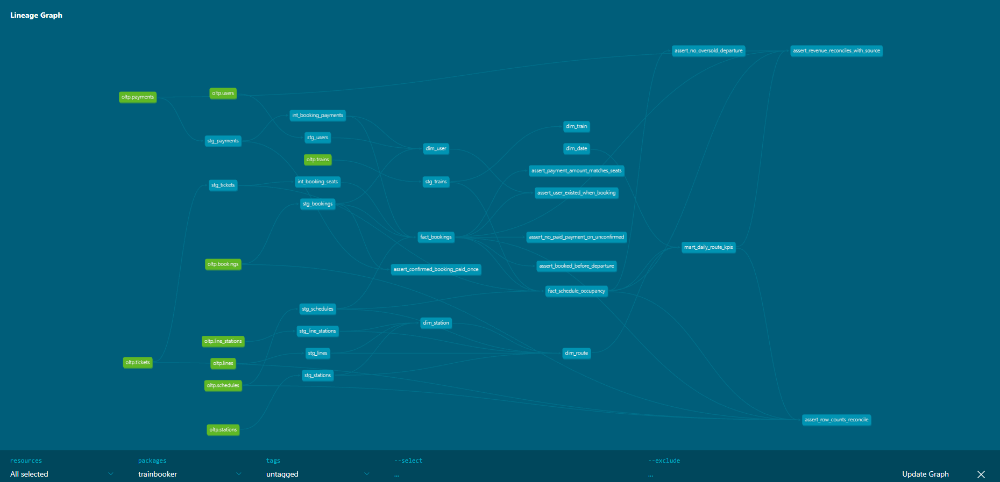

# TrainBooker Analytics
[](https://github.com/Worasakswu/trainbooker-analytics/actions/workflows/ci.yml) · [Live dbt docs & lineage graph](https://worasakswu.github.io/trainbooker-analytics/)

A train-ticket booking database for Thai rail routes, being extended step by step into an end-to-end data engineering project: from a hardened **OLTP database** to a **star-schema warehouse**, **data-quality tests**, **orchestration** and a **dashboard**.

> This project started as a group assignment for the Database course (CP242) at Srinakharinwirot University. See [Credits](#credits).

## Roadmap

| Phase | What | Status |
|---|---|---|
| 1 | Harden the OLTP schema: constraints, triggers, hashed passwords, Docker | ✅ Done |
| 2 | Generate realistic data (100k bookings) and bulk-load it, with data-quality checks | ✅ Done |
| 3 | Star-schema warehouse with dbt: 19 models, 66 tests | ✅ Done |
| 4 | CI with GitHub Actions + dbt docs on GitHub Pages | ✅ Done |
| 5 | Dashboard: occupancy, route revenue, cancellation rate | Planned |

## Quick start

Requires Docker and Python 3.10+.

```bash
python3 -m venv .venv && source .venv/bin/activate
pip install -r requirements.txt     # dbt-postgres (the generator itself needs nothing)
./scripts/run_pipeline.sh
```

This one command:
1. starts Postgres 16 on `localhost:5433` (schema + small seed data load on first start)
2. generates ~100k bookings as CSV files (`data/generated/`)
3. loads them into Postgres in a single transaction (~8 s)
4. runs the constraint tests and data-quality checks
5. builds the dbt warehouse and runs its 66 tests (`dbt build`)

Then explore:

```bash
docker compose exec -T db psql -U trainbooker -d trainbooker -f /sql/queries/data_profile.sql
docker compose exec -T db psql -U trainbooker -d trainbooker -f /sql/queries/example_queries.sql
```

Generator options: `./scripts/run_pipeline.sh --bookings 20000 --users 3000 --seed 7`.
The same `--seed` always produces exactly the same data.

To reset the database from scratch: `docker compose down -v && docker compose up -d`.

## Data model

```
lines ──< line_stations >── stations
                               │  (origin / destination)
trains ──< schedules >─────────┘
              │
users ──< bookings ──< tickets
              │
              └──< payments
```

| Table | Purpose |
|---|---|
| `lines`, `stations`, `line_stations` | Rail lines and the ordered stations on each. An interchange (Krung Thep Aphiwat) is one station on two lines. |
| `trains` | Train name, type (`AC` / `FAN`) and seat capacity |
| `schedules` | A train running from one station to another at a set time and price |
| `users` | Customers; passwords stored as bcrypt hashes |
| `bookings` | A user's booking on a schedule: `pending` → `confirmed` / `cancelled` |
| `tickets` | One seat for one passenger on a booking |
| `payments` | `paid` / `failed` / `refunded` payments for a booking |

## Business rules enforced by the database

| Rule | How |
|---|---|
| A seat can't be sold twice on the same schedule | Partial unique index on `(schedule_id, seat_number) WHERE is_active` |
| A train can't be oversold | `BEFORE INSERT` trigger compares active tickets with `total_seats`, locking the schedule row to handle concurrent sales |
| Cancelling a booking frees its seats | `AFTER UPDATE` trigger sets the booking's tickets to `is_active = false` |
| A ticket belongs to the same schedule as its booking | Composite foreign key `(booking_id, schedule_id)` |
| No duplicate schedules | `UNIQUE (train_id, departure_time)` |
| Valid times, prices and statuses | `CHECK` constraints (arrival > departure, origin ≠ destination, price ≥ 0, allowed status values) |
| No plain-text passwords | `pgcrypto` `crypt()` with bcrypt |

All of these are covered by [`sql/tests/test_constraints.sql`](sql/tests/test_constraints.sql), which tries to insert bad data and checks that the database rejects it.

## Synthetic data (Phase 2)

[`generator/generate_data.py`](generator/generate_data.py) simulates six months of bookings (Jan–Jun 2026) with patterns that later analytics can discover:

| Pattern | What the data shows (default seed) |
|---|---|
| Rush hours | Each morning departure (07:30–09:30) sells 1.6–1.9× the seats of the 11:30 train |
| Weekly cycle | Fridays (~1,000 seats/day) and Sundays (~980) vs. Tuesdays (~620) |
| Songkran | 1,500–2,100 people/day leave Bangkok on 10–12 Apr (~4× a normal day); the return rush peaks on 17 Apr |
| Sell-outs | Cheaper FAN trains on Songkran mornings reach 100% occupancy; extra demand is turned away |
| Booking lead time | Most people book within a week; holiday trips are booked earlier |
| Cancellations | 13% for bookings made 7+ days ahead vs. 5% for last-minute bookings |
| Heavy users | The top 10% of users make ~45% of all bookings (Pareto) |

**Pipeline:** Python writes CSVs → `\copy` into temporary staging tables → typed `INSERT` into the real tables. Loading through the real tables means every constraint and trigger (including the seat-capacity trigger) checks all 150k tickets. The whole load runs in one transaction, so a failure leaves the database unchanged.

**Data-quality checks** ([`sql/tests/test_data_quality.sql`](sql/tests/test_data_quality.sql)) cover rules that span several tables, which table constraints can't express. For example: a booking is made before departure and after the user signed up, every confirmed booking is paid exactly once, refunds only happen on cancelled bookings, and the payment amount equals price × seats.

| Table | Rows |
|---|---|
| users | 8,000 |
| schedules | 2,534 |
| bookings | ~99,700 |
| tickets | ~152,600 |
| payments | ~98,500 |

## Data warehouse with dbt (Phase 3)


The [`dbt/`](dbt/) project turns the OLTP tables into a star schema in three layers:

```
public (OLTP)          staging (views)        intermediate (views)       marts (tables)
─────────────          ───────────────        ────────────────────       ──────────────
users           ──►    stg_users        ─┐                          ┌──► dim_user
trains          ──►    stg_trains       ─┤                          ├──► dim_train
stations, lines ──►    stg_stations ... ─┤                          ├──► dim_station, dim_route
                                         │                          ├──► dim_date
schedules       ──►    stg_schedules    ─┤                          │
bookings        ──►    stg_bookings     ─┼──► int_booking_seats    ─┼──► fact_bookings            (1 row / booking)
tickets         ──►    stg_tickets      ─┤    int_booking_payments ─┼──► fact_schedule_occupancy  (1 row / departure)
payments        ──►    stg_payments     ─┘                          └──► mart_daily_route_kpis    (1 row / day x route)
```

| Model | Grain | Used for |
|---|---|---|
| `fact_bookings` | booking | seats, gross / paid / refunded amount, failed payment attempts, lead time, status flags |
| `fact_schedule_occupancy` | departure | seats sold vs. capacity, occupancy %, sold-out flag, revenue (includes departures with no bookings) |
| `mart_daily_route_kpis` | travel date × route | the dashboard table: occupancy, sell-outs, cancellation rate, revenue |
| `dim_date` | day | weekday / weekend, holiday period (Songkran, New Year) |
| `dim_route` | origin → destination | route name, line, direction (`outbound` / `inbound` from the Bangkok hub) |
| `dim_user` | customer | lifetime trips and revenue, segment (`frequent` / `regular` / `occasional` / `no_trips`) |

**66 tests** run with `dbt build`:
- *generic*: `unique`, `not_null`, `accepted_values`, and `relationships` from every fact key to its dimension
- *singular* ([`dbt/tests/`](dbt/tests/)): the Phase 2 business rules, plus **reconciliation tests** that check that no money or rows are gained or lost between the OLTP tables and the marts (total paid revenue in source = `fact_bookings` = `fact_schedule_occupancy` = `mart_daily_route_kpis`)

The password hash never leaves the OLTP database: `stg_users` doesn't select it.

Run dbt on its own:

```bash
cd dbt
dbt build --profiles-dir .                       # build all models + run all tests
dbt docs generate --profiles-dir . && dbt docs serve --profiles-dir .   # browse the lineage graph
```

What the warehouse shows (default seed):

| Question | Answer |
|---|---|
| Who brings the revenue? | 794 `frequent` users (10% of users) bring 45% of paid revenue |
| How full are the trains? | Outbound occupancy averages 15% on normal days but 27% during Songkran, when one departure sells out completely |
| Which direction earns more? | Outbound trips earn 2.4× inbound. The inbound timetable is midday-only and misses the commuter peaks |

## Highlight: journey planner with transfers

[`sql/queries/example_queries.sql`](sql/queries/example_queries.sql) Q7 uses a **recursive CTE** to find every route between two stations, including changes between lines, with a minimum transfer time. Example: Nakhon Pathom → Don Mueang on AC trains only:

| Itinerary | Legs | Total time | Price (THB) |
|---|---|---|---|
| South Express (Nakhon Pathom → Krung Thep Aphiwat) ⇒ North Express (→ Don Mueang) | 2 | 4:00 | 210 |
| InterCity (Nakhon Pathom → Krung Thep Aphiwat) ⇒ North Express (→ Don Mueang) | 2 | 2:30 | 240 |

The course version answered this with hard-coded station names for one route; this version works for any pair of stations.

## What changed from the course version

- Fixed a column-name mismatch (`Locations` vs `Location`) that made the original script fail
- Normalized stations so a shared station isn't stored twice
- Removed a duplicate schedule row and fixed inconsistent seed data (payment amount ≠ ticket price, payment recorded for a pending booking)
- Added constraints, triggers, indexes, audit timestamps (`created_at`, `booked_at`, `paid_at`) and hashed passwords
- Switched to `snake_case` names and `TIMESTAMPTZ` (Asia/Bangkok)
- Added Docker setup and automated constraint tests

## Project structure

```
├── docker-compose.yml
├── requirements.txt          # dbt-postgres
├── scripts/run_pipeline.sh   # generate -> load -> test -> dbt build, in one command
├── generator/
│   └── generate_data.py      # synthetic booking history -> CSV
├── data/generated/           # CSV output (git-ignored, reproducible)
├── dbt/                      # warehouse: staging -> intermediate -> marts, tests
├── sql/
│   ├── init/                 # 01_schema.sql, 02_seed.sql — loaded automatically by Docker
│   ├── load/                 # load_generated.sql — CSV -> staging -> tables
│   ├── queries/              # example_queries.sql, data_profile.sql
│   └── tests/                # test_constraints.sql, test_data_quality.sql
└── docs/                     # ERD and original course materials
```

## Credits

The original TrainBooker database (Phase 0) was designed for the Database course (CP242) at Srinakharinwirot University by:

- Kritchatrin Boonsoo
- Nathaphon Suanyai
- Worasak Sankla

Phases 1 onward are developed by Worasak Sankla.
