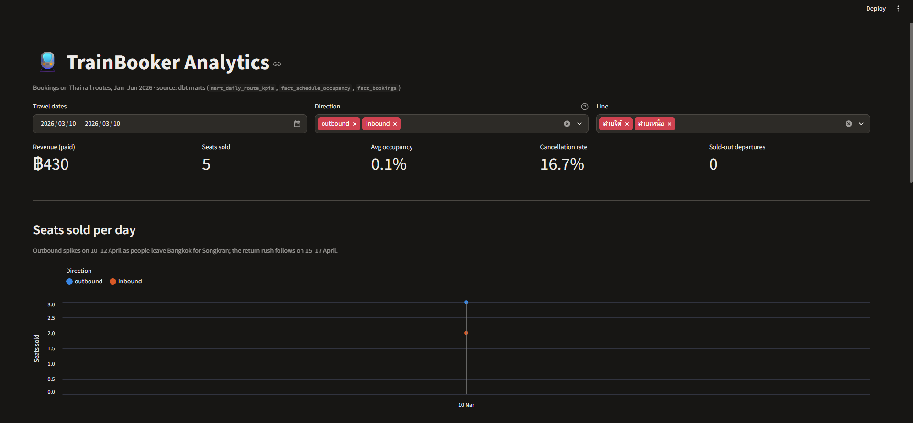

# TrainBooker dashboard

A Streamlit app on top of the dbt marts (`mart_daily_route_kpis`, `fact_schedule_occupancy`, `fact_bookings`, `dim_*`).



## Run

```bash
# from the repo root, with the database up and `dbt build` done
pip install -r dashboard/requirements.txt
streamlit run dashboard/app.py
```

It connects to `localhost:5544` by default. Override with `TB_PG_HOST`, `TB_PG_PORT`, `TB_PG_USER`, `TB_PG_PASSWORD`, `TB_PG_DB`.

## What's on it

| Section | Source | Shows |
|---|---|---|
| KPI tiles | `mart_daily_route_kpis` | paid revenue, seats sold, occupancy, cancellation rate, sell-outs |
| Seats sold per day | `mart_daily_route_kpis` | the Songkran outbound rush (10–12 Apr) and the return rush (15–17 Apr) |
| Occupancy by departure hour | `fact_schedule_occupancy` | morning commuter peak |
| Avg seats per weekday | `mart_daily_route_kpis` + `dim_date` | Friday / Sunday peaks |
| Cancellation by lead time | `fact_bookings` | early bookers cancel ~2.6× as often |
| Revenue by segment | `fact_bookings` + `dim_user` | ~10% of users bring ~45% of revenue |
| Busiest departures | `fact_schedule_occupancy` + `dim_train` | which departures sell out |

All charts react to the filters (travel dates, direction, line). Every chart has hover tooltips, and the daily data is also available as a table. Colors are validated for color-blind separation, with separate steps for light and dark themes.
